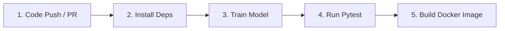

# 🎯 Simple MLOps Project: End-to-End Pipeline
> **A clean, easy-to-understand MLOps demonstration covering Model Training, FastAPI Serving, Docker, Kubernetes, and CI/CD.**

---

## 💡 What This Project Demonstrates to Your Manager

This project illustrates the complete lifecycle of putting a Machine Learning model into production using modern DevOps/MLOps industry practices, kept simple and accessible:

| MLOps Pillar | File | What it does |
| :--- | :--- | :--- |
| **1. Model Training** | [`train.py`](train.py) | Trains a classification model on the Iris dataset and saves the artifact (`model.joblib`). |
| **2. API Serving** | [`app.py`](app.py) | Serves the model via a high-performance FastAPI REST API (`/health` and `/predict`). |
| **3. Automated Testing** | [`test_app.py`](test_app.py) | Tests the model training output and API endpoints using `pytest`. |
| **4. Containerization** | [`Dockerfile`](Dockerfile) | Packages the application, dependencies, and model into an immutable Docker image. |
| **5. Orchestration** | [`k8s/deployment.yaml`](k8s/deployment.yaml) | Deploys 2 replicated pods with a Kubernetes Service for high availability and load balancing. |
| **6. CI/CD Automation** | [`.github/workflows/cicd.yaml`](.github/workflows/cicd.yaml) | Automatically runs tests and builds the Docker image on every GitHub push. |

---

## 📂 Project Structure (Flat & Minimal)

```text
mlopsnew/
├── .github/workflows/
│   └── cicd.yaml        # 30-line GitHub Actions CI/CD workflow
├── k8s/
│   └── deployment.yaml  # Kubernetes Deployment (2 replicas) + Service
├── app.py               # FastAPI application (/health and /predict)
├── train.py             # Trains model & exports model.joblib
├── test_app.py          # Pytest automated test suite
├── Dockerfile           # Minimal 9-line Dockerfile
├── requirements.txt     # Python dependencies
├── run.ps1              # One-click command helper for PowerShell
└── README.md            # Manager presentation guide
```

---

## 🎬 5-Minute Live Demo Script for Your Manager

You can walk your manager through this 5-step demo using the included `run.ps1` helper:

### Step 1: Train the Machine Learning Model
```powershell
.\run.ps1 train
```
> **What to say:** *"Here, `train.py` loads the dataset, splits it into training and testing sets, trains a Random Forest model, and serializes the trained model into `model.joblib`."*

---

### Step 2: Run Automated Tests
```powershell
.\run.ps1 test
```
> **What to say:** *"Before deploying anything to production, our automated tests in `test_app.py` ensure the model is created properly and our API endpoints respond with expected predictions."*

---

### Step 3: Start the REST API & Test Predictions
```powershell
.\run.ps1 serve
```
1. Open the interactive Swagger UI in the browser: **http://localhost:8000/docs**
2. Show the `/health` endpoint (returns `{"status": "healthy", "model_loaded": true}`).
3. Open a second PowerShell terminal and run:
   ```powershell
   .\run.ps1 predict
   ```
> **What to say:** *"FastAPI loads the trained model in memory. When client applications send measurements via JSON, our API instantly predicts the class with sub-millisecond latency."*

---

### Step 4: Docker Containerization
Show the clean [Dockerfile](Dockerfile):
```dockerfile
FROM python:3.11-slim
WORKDIR /app
COPY requirements.txt .
RUN pip install --no-cache-dir -r requirements.txt
COPY . .
EXPOSE 8000
CMD ["uvicorn", "app:app", "--host", "0.0.0.0", "--port", "8000"]
```
Commands to build and run the container:
```powershell
# Build image
.\run.ps1 docker-build

# Run container
.\run.ps1 docker-run
```
> **What to say:** *"By containerizing our ML model with Docker, we eliminate 'it works on my machine' issues. The exact same container image runs locally, in staging, and in cloud production."*

---

### Step 5: Kubernetes Orchestration
Show the clean [k8s/deployment.yaml](k8s/deployment.yaml):
- **Deployment:** Creates **2 replicas** (pods) of the model container for high availability.
- **Service:** Exposes port 8000 so incoming user traffic is balanced across both pods.

Deploying to Kubernetes:
```powershell
# Deploy
.\run.ps1 k8s-deploy

# Check pods
.\run.ps1 k8s-status
```
> **What to say:** *"In production, Kubernetes manages our containers. If one container crashes, Kubernetes immediately spins up a replacement. If traffic spikes, we can increase the replica count seamlessly."*

---

### Step 6: Automated CI/CD (GitHub Actions)
Show [`.github/workflows/cicd.yaml`](.github/workflows/cicd.yaml):

> **What to say:** *"Whenever a data scientist or engineer pushes changes to GitHub, our CI/CD pipeline triggers automatically. It verifies dependencies, trains the model, runs tests, and builds the Docker image. If any test fails, it prevents broken code from reaching production."*

---

## 📋 Summary of Key Takeaways

1. **Reproducibility:** Versioned dependencies in `requirements.txt` and repeatable training in `train.py`.
2. **Standardization:** Serving ML via standard REST APIs (FastAPI) rather than ad-hoc scripts.
3. **Portability:** Docker guarantees identical execution in all environments.
4. **Resilience:** Kubernetes ensures self-healing and zero downtime.
5. **Quality Assurance:** CI/CD automates testing and container builds on every commit.
