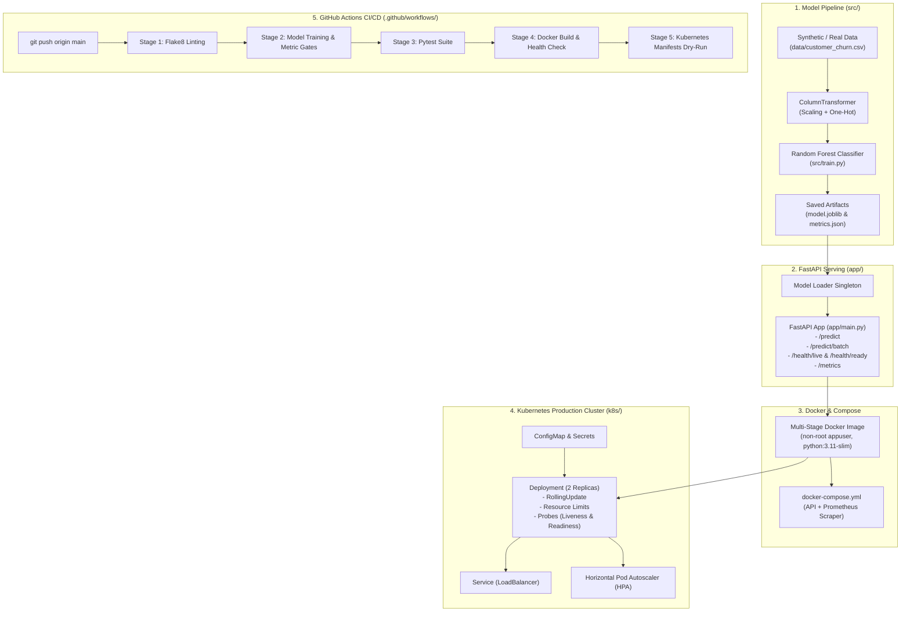
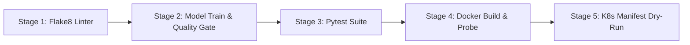

# 🚀 End-to-End MLOps Project: Customer Churn Predictor
### *Hands-on Architecture featuring Scikit-Learn, FastAPI, Docker, Kubernetes, Prometheus & GitHub Actions CI/CD*

[](https://github.com/your-username/mlops-churn-predictor/actions)
[](https://www.python.org/)
[](https://www.docker.com/)
[](https://kubernetes.io/)
[](https://fastapi.tiangolo.com/)

---

## 📌 Project Architecture



---

## 📂 Repository Structure

```text
├── .github/
│   └── workflows/
│       └── ci-cd.yaml          # Automated CI/CD pipeline (Lint, Train, Test, Docker, K8s)
├── app/
│   ├── __init__.py
│   ├── main.py                 # FastAPI inference service + Prometheus instrumentation
│   ├── model_loader.py         # Thread-safe model artifact loader
│   └── schemas.py              # Pydantic v2 schemas for request/response validation
├── src/
│   ├── __init__.py
│   ├── data_pipeline.py        # Data generator, split, and Scikit-Learn ColumnTransformer
│   └── train.py                # Model training, metric calculation, artifact persistence
├── tests/
│   ├── __init__.py
│   ├── test_api.py             # API endpoints, health probes, validation & error tests
│   └── test_train.py           # Data generation, pipeline transformation & model tests
├── k8s/
│   ├── namespace.yaml          # Production namespace (mlops-prod)
│   ├── configmap.yaml          # Environment configs (MODEL_PATH, LOG_LEVEL, PORT)
│   ├── secret.yaml             # API secret key template
│   ├── deployment.yaml         # 2 replicas, securityContext, probes, resource limits
│   ├── service.yaml            # LoadBalancer service exposing port 80 -> 8000
│   ├── hpa.yaml                # Autoscaling from 2 to 5 pods on CPU/Memory thresholds
│   └── kustomization.yaml      # Declarative resource bundle
├── artifacts/
│   ├── model.joblib            # Trained Scikit-Learn pipeline
│   ├── metrics.json            # Accuracy, F1, Precision, Recall, ROC-AUC
│   └── sample_input.json       # Clean sample test vector
├── Dockerfile                  # Secure, multi-stage, non-root container image
├── .dockerignore               # Slim build context
├── docker-compose.yml          # Local full-stack runtime (FastAPI + Prometheus)
├── prometheus.yml              # Prometheus scraping configuration
├── requirements.txt            # Pinned project dependencies
├── .flake8                     # Linting configuration
├── Makefile                    # Standard commands for Linux/macOS
├── run.ps1                     # Windows PowerShell one-click CLI
└── README.md                   # Comprehensive guide
```

---

## 🛠️ Step-by-Step Hands-on Guide

### Step 1: Environment Setup

#### Option A: Windows (PowerShell)
```powershell
# Run the built-in helper script:
.\run.ps1 setup
```

#### Option B: Manual / Linux / macOS
```bash
python3 -m venv .venv
source .venv/bin/activate       # On Windows: .\.venv\Scripts\Activate.ps1
pip install --upgrade pip
pip install -r requirements.txt
```

---

### Step 2: Train the Machine Learning Model

The training script generates synthetic customer data (or loads `data/customer_churn.csv`), builds a composite `ColumnTransformer` (standard scaler for numericals + one-hot encoder for categoricals), trains a `RandomForestClassifier`, evaluates classification metrics, and exports `artifacts/model.joblib` and `artifacts/metrics.json`.

```bash
# Using helper:
.\run.ps1 train

# Or directly:
python -m src.train
```

**Output:**
```text
============================================================
🚀 Starting MLOps Training Pipeline
============================================================
📊 Dataset loaded: 2000 rows, 11 columns
✂️  Train set: 1600 samples | Test set: 400 samples
🏋️  Training Random Forest model...

📈 Evaluation Metrics:
   - accuracy: 0.7625
   - precision: 0.3000
   - recall: 0.3134
   - f1_score: 0.3066
   - roc_auc: 0.6494
   - train_samples: 1600
   - test_samples: 400
💾 Model saved to: artifacts/model.joblib
💾 Metrics saved to: artifacts/metrics.json
```

---

### Step 3: Run Automated Tests & Code Linting

Run unit and integration tests covering the pipeline, model output, FastAPI endpoints, input validation, and Prometheus metrics.

```bash
# Run pytest:
.\run.ps1 test
# Or: pytest -v tests/

# Run flake8 linter:
flake8 .
```

---

### Step 4: Run the API Server Locally

Launch the FastAPI application with live reloading:

```bash
.\run.ps1 serve
# Or: uvicorn app.main:app --host 0.0.0.0 --port 8000 --reload
```

Once running:
- **Interactive Swagger Docs**: [http://localhost:8000/docs](http://localhost:8000/docs)
- **Liveness Probe**: [http://localhost:8000/health/live](http://localhost:8000/health/live)
- **Readiness Probe**: [http://localhost:8000/health/ready](http://localhost:8000/health/ready)
- **Prometheus Metrics**: [http://localhost:8000/metrics](http://localhost:8000/metrics)
- **Model Info**: [http://localhost:8000/model/info](http://localhost:8000/model/info)

#### Test a Prediction via CLI:
```powershell
.\run.ps1 predict-sample
```
Or with `curl`:
```bash
curl -X POST "http://localhost:8000/predict" \
     -H "Content-Type: application/json" \
     -d '{
       "credit_score": 650,
       "country": "Germany",
       "gender": "Female",
       "age": 42,
       "tenure": 5,
       "balance": 85000.5,
       "num_of_products": 2,
       "has_cr_card": 1,
       "is_active_member": 1,
       "estimated_salary": 65000.0
     }'
```

**Response:**
```json
{
  "churn_prediction": 0,
  "churn_probability": 0.3412,
  "risk_level": "Low",
  "model_version": "v1.0.0"
}
```

---

### Step 5: Containerize with Docker

The provided `Dockerfile` uses **multi-stage build** principles:
1. **Builder Stage**: Installs compiler tools and builds wheels.
2. **Runtime Stage**: Uses minimal `python:3.11-slim`, copies virtualenv, creates a dedicated non-root user `appuser` (UID 10001), and configures a built-in Docker `HEALTHCHECK`.

```bash
# 1. Build Docker image
docker build -t mlops-churn-api:latest .

# 2. Run container
docker run -d -p 8000:8000 --name churn-serving mlops-churn-api:latest

# 3. Check health and logs
docker ps
docker logs -f churn-serving

# 4. Stop container
docker stop churn-serving && docker rm churn-serving
```

---

### Step 6: Multi-Container Stack (FastAPI + Prometheus) with Docker Compose

Run the API alongside Prometheus to see real-time metrics scraping:

```bash
# Start both services in background:
docker-compose up --build -d

# Check running services:
docker-compose ps
```

- Open **Prometheus UI**: [http://localhost:9090](http://localhost:9090)
- In Prometheus expression bar, try querying:
  - `api_requests_total`
  - `model_churn_predictions_total`
  - `api_request_duration_seconds_count`

To stop:
```bash
docker-compose down
```

---

### Step 7: Deploy to Kubernetes (Production-Ready Manifests)

The manifests in `k8s/` are built according to cloud-native best practices:
- **`namespace.yaml`**: Isolates resources into `mlops-prod`.
- **`configmap.yaml` & `secret.yaml`**: Externalizes environment variables and sensitive keys.
- **`deployment.yaml`**:
  - `replicas: 2` with `RollingUpdate` strategy (zero downtime updates).
  - `securityContext`: Enforces non-root user (`runAsNonRoot: true`, UID 10001).
  - `resources`: CPU and memory requests & limits.
  - `readinessProbe`: Hits `/health/ready` before sending network traffic.
  - `livenessProbe`: Hits `/health/live` to restart unresponsive pods.
  - `startupProbe`: Protects slow initialization models.
- **`service.yaml`**: Exposes the pods via a LoadBalancer on port 80.
- **`hpa.yaml`**: Horizontal Pod Autoscaler dynamically scales between 2 to 5 replicas based on CPU/Memory load.

#### Local Kubernetes Options on Windows:
1. **Docker Desktop Kubernetes**: Enable Kubernetes in Docker Desktop Settings -> Apply & Restart.
2. **Minikube**: `minikube start --driver=docker`
3. **Kind**: `kind create cluster --name mlops`

#### Deploying:
```bash
# Apply all manifests using Kustomize:
kubectl apply -k k8s/

# Or via PowerShell script:
.\run.ps1 k8s-apply

# Verify pods, services, and HPA:
kubectl get all,hpa -n mlops-prod
```

**Sample Output:**
```text
NAME                                   READY   STATUS    RESTARTS   AGE
pod/mlops-churn-api-7b8978cdb5-abcde   1/1     Running   0          45s
pod/mlops-churn-api-7b8978cdb5-fghij   1/1     Running   0          45s

NAME                          TYPE           CLUSTER-IP      EXTERNAL-IP   PORT(S)
service/mlops-churn-service   LoadBalancer   10.96.120.45    localhost     80:31234/TCP

NAME                                              REFERENCE                    TARGETS   MINPODS   MAXPODS
horizontalpodautoscaler.autoscaling/mlops-churn   Deployment/mlops-churn-api   5%/70%    2         5
```

#### Test Kubernetes Pod Auto-Healing:
Delete one pod and observe Kubernetes instantly starting a replacement to maintain 2 replicas:
```bash
kubectl delete pod -l app=mlops-churn-api -n mlops-prod
kubectl get pods -n mlops-prod -w
```

#### Clean up Kubernetes:
```bash
kubectl delete -k k8s/
```

---

### Step 8: Continuous Integration & Continuous Delivery (CI/CD)

The workflow defined in `.github/workflows/ci-cd.yaml` executes automatically on every push or pull request to `main`/`master`:



1. **Stage 1: Linting**: Fails if Python syntax errors or undefined variables exist.
2. **Stage 2: Training & Performance Gate**: Trains the model and verifies `accuracy >= 0.65` and `roc_auc >= 0.60`. Uploads artifacts to GitHub.
3. **Stage 3: Automated Testing**: Executes 11 test cases covering data pipeline, API validation, and metrics.
4. **Stage 4: Docker Build & Health Check**: Builds image and runs a live test container in the GitHub runner, probing `/health/live` and `/predict`.
5. **Stage 5: Kubernetes Dry-Run**: Validates manifests with `kubectl apply --dry-run=client -k k8s/`.

#### How to push to your GitHub:
```bash
git add .
git commit -m "feat: initial end-to-end MLOps pipeline"
git branch -M main
git remote add origin https://github.com/<your-username>/<your-repo-name>.git
git push -u origin main
```
Navigate to your GitHub repository -> **Actions** tab to watch the automated pipeline execute!

---

## 🎯 Summary of Hands-on Skills Mastered

| Domain | Skills Acquired |
| :--- | :--- |
| **Machine Learning** | Data pipelines, `ColumnTransformer` feature scaling, train/test split, Random Forest classification, metric evaluation, model artifact serialization (`joblib`). |
| **API Serving** | FastAPI, Pydantic v2 data models, asynchronous request handling, exception handlers, batch scoring. |
| **Monitoring** | Prometheus metrics instrumentation (`Counter`, `Histogram`), `/metrics` endpoint, Prometheus server setup. |
| **Docker** | Multi-stage Docker builds, `.dockerignore` optimization, non-root security context (`appuser`), Docker healthchecks, `docker-compose`. |
| **Kubernetes** | Declarative YAMLs, Namespaces, ConfigMaps, Secrets, Deployments, Rolling Updates, Liveness & Readiness Probes, Resource requests/limits, Services, HPA autoscaling, Kustomize. |
| **CI/CD** | GitHub Actions workflows, multi-stage CI pipelines, quality gates, automated artifact storage, container testing in CI, Kubernetes dry-run linting. |

---

**Developed for hands-on MLOps mastery! Happy learning!** 🚀
